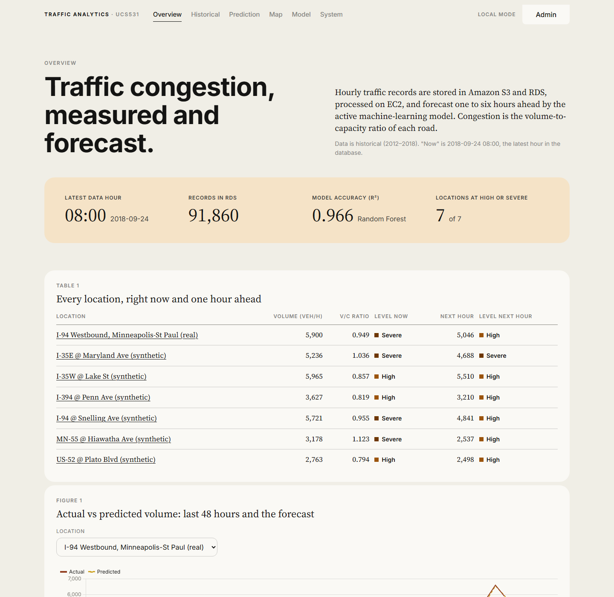
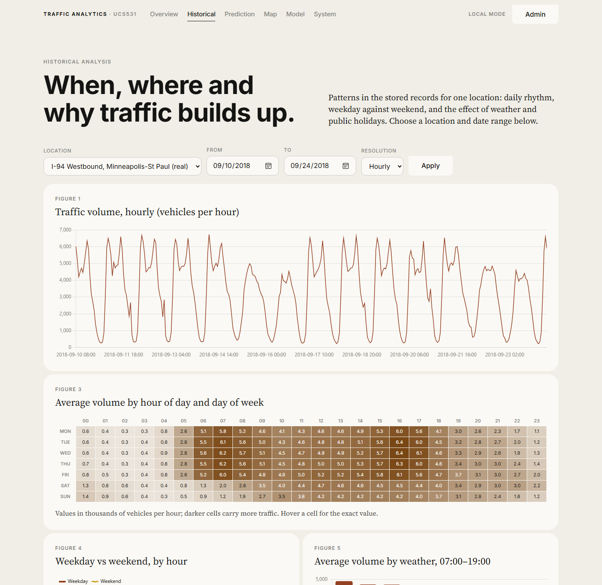
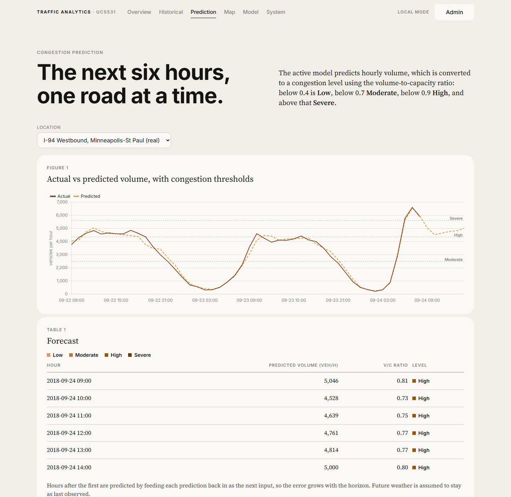
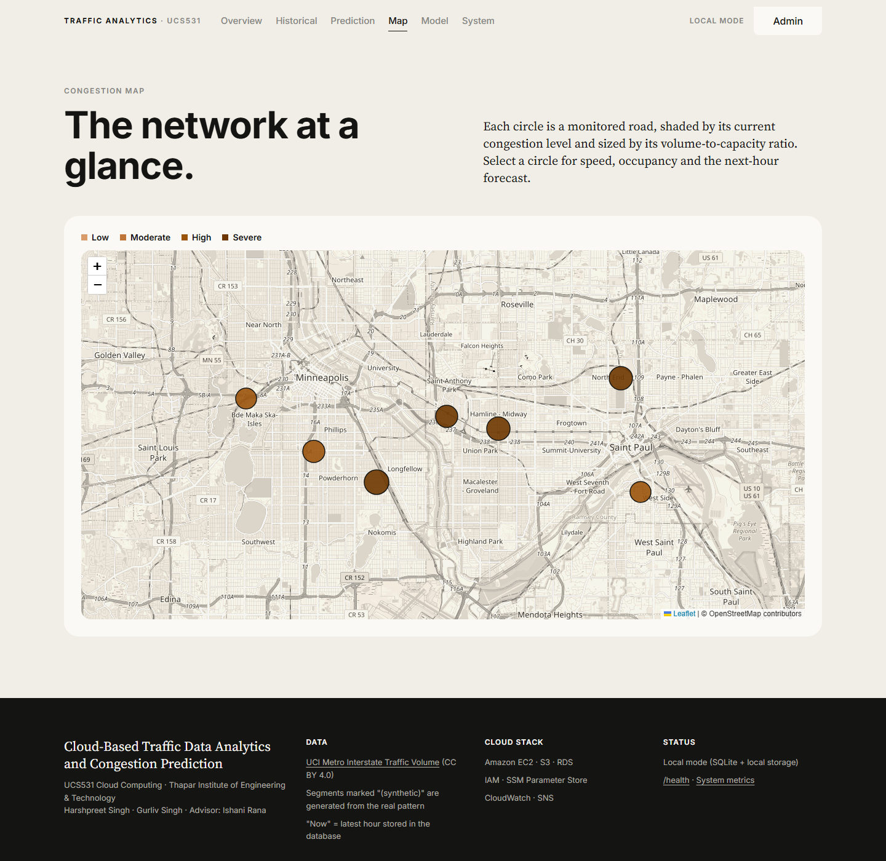
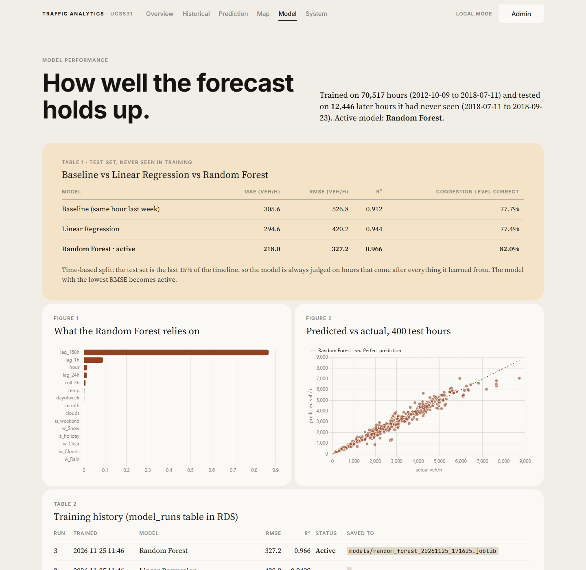
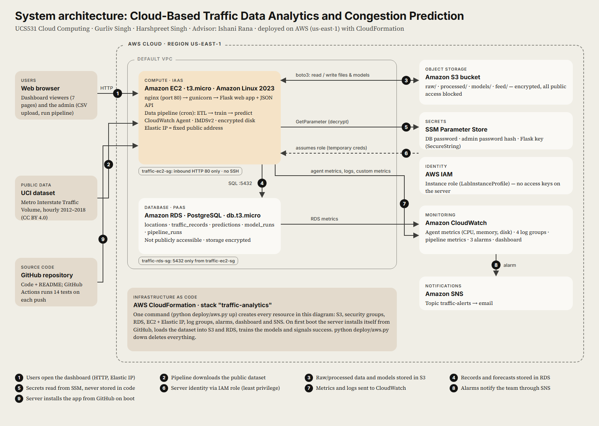
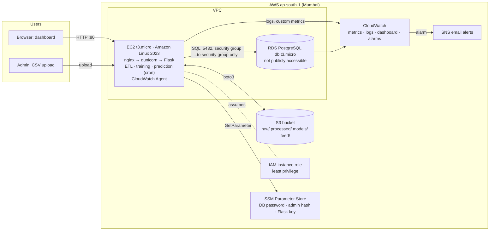

# Cloud-Based Traffic Data Analytics and Congestion Prediction

[](https://github.com/gurlivsingh/cloud-traffic-analytics/actions/workflows/tests.yml)


A cloud-hosted web application that stores historical traffic data, analyses congestion patterns and forecasts
congestion up to six hours ahead. Data lives in **Amazon S3** and **Amazon RDS**. Processing, machine learning and the
web dashboard run on **Amazon EC2**. **IAM**, security groups and **SSM Parameter Store** secure the system, and
**Amazon CloudWatch** with **SNS** monitors it.

*UCS531 Cloud Computing semester project · Lab L430 · Faculty advisor: Ishani Rana*

**New to the project?** Read the full [project guide](docs/PROJECT_GUIDE.md), which covers cloud concepts, how
every requirement is met, the technical details and viva Q&A. Or watch the
[narrated video walkthrough](docs/video/project-walkthrough.mp4) of every page.



## Contents
- [Problem and objectives](#problem-and-objectives)
- [What it does](#what-it-does)
- [Architecture](#architecture)
- [Data and methodology](#data-and-methodology)
- [Results](#results)
- [Getting started (local)](#getting-started-local)
- [Deploying on AWS](#deploying-on-aws)
- [Testing](#testing)
- [Security](#security)
- [Project status](#project-status)
- [Repository layout](#repository-layout)
- [Limitations](#limitations)
- [Team and acknowledgements](#team-and-acknowledgements)

## Problem and objectives

Traffic datasets contain large volumes of time- and location-dependent records that reveal congestion patterns.
Processing and serving them from a single local machine limits scalability and availability.

**Objectives** (from our proposal):
1. Store historical traffic data in cloud object storage and a cloud-hosted relational database.
2. Run analytics in the cloud and classify each road's congestion level.
3. Predict near-future traffic from historical patterns with a lightweight model (Linear Regression or Random Forest).
4. Present current and historical congestion, predictions and system metrics on a web dashboard.
5. Use identity and access controls and cloud monitoring for security and resource management.
6. Use only publicly available or synthetically generated data.

## What it does

| Page | Contents |
|---|---|
| **Overview** | Current congestion at every road, the next-hour forecast, and the last 48 hours of actual vs predicted volume |
| **Historical** | Volume (and speed, where available) over any date range; hour × weekday heatmap; weekday vs weekend; weather and holiday effects; time spent at each congestion level |
| **Prediction** | 6-hour forecast per road, with Moderate, High and Severe thresholds marked on the chart |
| **Map** | Every monitored road on an OpenStreetMap base, shaded by congestion level |
| **Model** | Baseline vs Linear Regression vs Random Forest on unseen data, feature importance, predicted vs actual |
| **System** | Health of S3 and RDS, live CloudWatch metrics (EC2 CPU and memory, RDS CPU and connections), every pipeline run |
| **Admin** (login) | Upload a CSV to S3, run the pipeline, stream the next hour of the simulated live feed |

| Historical | Prediction |
|---|---|
|  |  |
| **Map** | **Model** |
|  |  |

## Architecture





**Data flow:**
1. A CSV lands in `s3://<bucket>/raw/`, uploaded either through the Admin page or by `prepare_data`.
2. **ETL** ([`pipeline/etl.py`](pipeline/etl.py)) cleans it and computes congestion. It writes a processed copy to `processed/` and upserts records into RDS.
3. **Training** ([`pipeline/train.py`](pipeline/train.py)) compares three models on a time-based split, saves the best one to `models/`, and records every run in RDS.
4. **Prediction** ([`pipeline/predict.py`](pipeline/predict.py)) loads the active model from S3 and writes 1–6 hour forecasts to RDS.
5. The **Flask** app reads RDS and CloudWatch and serves the dashboard.

Cron runs steps 2 and 4 every hour, and steps 2–4 every night. A lock file prevents two runs from overlapping.

| AWS service | Role in the project | Cloud concept shown |
|---|---|---|
| EC2 | Web application, ETL, training and prediction | IaaS, virtualization |
| S3 | Raw and processed datasets, trained models, live feed | Object storage, durability |
| RDS (PostgreSQL) | Traffic records, predictions, model and pipeline history | Managed database (PaaS) |
| IAM | Users with MFA; EC2 instance role instead of access keys | Identity, least privilege |
| Security groups | Port 80 open to the web; RDS reachable **only** from the EC2 security group | Network isolation |
| SSM Parameter Store | Encrypted secrets (SecureString) | Secrets management |
| CloudWatch + SNS | Agent metrics, logs, custom pipeline metrics, dashboard, alarms, email alerts | Monitoring, observability |

## Data and methodology

**Data**
- **Real:** [UCI Metro Interstate Traffic Volume](https://archive.ics.uci.edu/dataset/492/metro+interstate+traffic+volume) (CC BY 4.0). Hourly westbound I-94 volume in Minneapolis–St Paul, Oct 2012 – Sep 2018, with weather and public holidays.
- **Synthetic:** six nearby road segments generated from the real hourly pattern (scaled, time-shifted, with noise), with derived speed and occupancy. They are labelled **"(synthetic)"** everywhere.
- **Live feed:** the last 7 days are held back in `s3://…/feed/` and streamed in one hour at a time to demonstrate continuous ingestion.

**Preprocessing:**
- removes duplicate hours (the source repeats an hour for each weather tag)
- treats 0 K temperatures as missing and converts Kelvin to °C
- removes an impossible 9,831 mm/h rainfall value
- spreads each holiday from its midnight row to the whole day

**Congestion.** The volume-to-capacity (V/C) ratio, a standard traffic-engineering measure. Capacity is the 95th
percentile of a road's hourly volume, because the true capacity isn't in the data.

| V/C ratio | < 0.40 | 0.40 – 0.70 | 0.70 – 0.90 | ≥ 0.90 |
|---|---|---|---|---|
| Level | Low | Moderate | High | Severe |

**Prediction.**
- **Target:** traffic volume one hour ahead. Longer horizons, up to 6 hours, feed each prediction back in as the next input.
- **Features:**
  - time: hour, day of week, month, weekend, holiday
  - weather: temperature, rain, snow, cloud cover, weather type
  - lags: 1 hour, 24 hours, 168 hours, and the previous 3-hour mean
- **No leakage:** every lag uses only past hours, which [`tests/test_features.py`](tests/test_features.py) checks.
- **Models:** a naive baseline (same hour last week), Linear Regression, and Random Forest.
- **Evaluation:** a **time-based split**, with the last 15% of the timeline held out, so models are always tested on later, unseen hours.
- **Metrics:** MAE, RMSE, R², and how often the predicted congestion *level* is correct.

## Results

From a local end-to-end run on the full dataset. Reproduce with `python -m pipeline.prepare_data && python -m pipeline.run_all`.

| Model | MAE (veh/h) | RMSE (veh/h) | R² | Congestion level correct |
|---|---|---|---|---|
| Baseline (same hour last week) | 305.6 | 526.8 | 0.912 | 77.7% |
| Linear Regression | 294.6 | 420.2 | 0.944 | 77.4% |
| **Random Forest** (active) | **218.0** | **327.2** | **0.966** | **82.0%** |

Train: 70,517 hours (Oct 2012 – Jul 2018). Test: 12,446 later hours (Jul – Sep 2018). The Random Forest lowers RMSE by
38% against the baseline and 22% against Linear Regression. Its most important inputs are the same-hour-last-week and
previous-hour volumes.

## Getting started (local)

No AWS account is needed. When `S3_BUCKET` and `DB_HOST` are empty, the same code uses SQLite and a local `storage/` folder.

```powershell
py -3.12 -m venv .venv
.venv\Scripts\pip install -r requirements-dev.txt
.venv\Scripts\python -m pipeline.prepare_data      # download the dataset, build raw/ and feed/
.venv\Scripts\python -m pipeline.run_all           # ETL -> train -> predict (about 15 seconds)
.venv\Scripts\python -m flask --app app.app run    # http://127.0.0.1:5000  (local admin password: admin)
```

To watch the "live" feed, run `python -m pipeline.replay_feed --interval 30 --hours 10`, or use *Stream next hour* on the Admin page.

## Deploying on AWS

The full step-by-step guide is in **[docs/DEPLOYMENT.md](docs/DEPLOYMENT.md)**. In brief:
1. Set up budgets and MFA.
2. Create an S3 bucket, plus SSM secrets and security groups.
3. Create RDS PostgreSQL (not public).
4. Create an EC2 role with the [least-privilege policy](deploy/iam-ec2-policy.json).
5. Launch EC2 (Amazon Linux 2023) and run [`deploy/setup_ec2.sh`](deploy/setup_ec2.sh). It configures swap, the venv, gunicorn under systemd, nginx, cron and the CloudWatch Agent.
6. Run [`deploy/create_monitoring.sh`](deploy/create_monitoring.sh) in CloudShell for the alarms, dashboard and SNS email.

The guide also covers security checks, load testing, scaling, cost and teardown. It works on AWS Academy Learner Lab too.

## Testing

```powershell
.venv\Scripts\python -m pytest -q
```

14 tests run on every push through [GitHub Actions](.github/workflows/tests.yml):
- congestion thresholds
- no leakage in lag features, including across missing hours
- every data-cleaning rule
- an end-to-end run (storage → ETL → database → training → prediction → API)
- no duplicate rows when a file is reloaded
- admin login enforcement
- rejection of invalid uploads

A load test is in [`loadtest/locustfile.py`](loadtest/locustfile.py).

## Security

- **No credentials on the server.** EC2 uses an IAM role. The database password, admin password hash and session key are SecureStrings in SSM Parameter Store.
- **Least privilege.** The EC2 role can touch only this bucket, only `/traffic/*` parameters, and CloudWatch metrics.
- **Network isolation.** RDS isn't publicly accessible and accepts connections only from the EC2 security group. The S3 bucket blocks all public access.
- **Application:**
  - The admin pages need a login (password stored as a hash).
  - Session cookies are `HttpOnly` and `SameSite=Lax`, which protects against cross-site requests.
  - Uploads are limited to 20 MB and validated before anything reaches S3.
  - All SQL is parameterised.
- **No secrets in Git.** `.env`, data and models are git-ignored.

## Project status

Every requirement from the course brief and our proposal is tracked in **[docs/REQUIREMENTS.md](docs/REQUIREMENTS.md)**,
with the evidence for each one.

| Deliverable | Status |
|---|---|
| Proposal | ✔ Submitted |
| Architecture diagram | ✔ [Above](#architecture) |
| Working implementation | ✔ Verified locally on the real dataset |
| Source code and README | ✔ This repository |
| Cloud deployment and demonstration | ✔ Live on AWS via CloudFormation (us-east-1), security checks passed |
| Report (≤ 5 pages) | ✔ Submitted on the LMS |
| Presentation and live demo | ⏳ Lab evaluation, 1 Dec 2026 |

## Repository layout

```
config.py                settings from env / .env (local fallback: SQLite + ./storage)
cloud.py                 S3, SSM and CloudWatch wrappers
db.py                    schema (5 tables) and idempotent upserts
pipeline/
  prepare_data.py        download the dataset, add synthetic segments, upload raw/ + feed/
  etl.py                 normalise, clean, congestion -> S3 processed/ + RDS
  congestion.py          V/C ratio and levels
  features.py            time, weather and lag features
  train.py               baseline vs LR vs RF; best model saved to S3
  predict.py             backfill + 6-hour recursive forecast
  run_all.py             ETL -> train -> predict (cron and the Admin button)
  replay_feed.py         simulated live sensor feed
app/                     Flask app: routes, templates, static CSS/JS
deploy/                  EC2 setup, systemd, nginx, cron, CloudWatch Agent, IAM policy, monitoring script
docs/                    REQUIREMENTS.md, DEPLOYMENT.md, screenshots/
tests/                   pytest suite
loadtest/                Locust load test
```

## Limitations

- Road capacity is estimated (95th percentile of volume), because the data doesn't include it.
- Only one real station exists. The other six roads are synthetic, so the map illustrates the method rather than a real network.
- Forecasts beyond one hour carry the last observed weather forward and accumulate error.
- The dataset is historical (2012–2018). "Now" means the latest hour in the database.

## Team and acknowledgements

| Member | |
|---|---|
| Gurliv Singh | UCS531, Lab L430 |
| Harshpreet Singh | UCS531, Lab L430 |

Faculty advisor: **Ishani Rana**.

Dataset: John Hogue, *Metro Interstate Traffic Volume*, UCI Machine Learning Repository (2019), CC BY 4.0.
Map data © OpenStreetMap contributors. Built with Flask, pandas, scikit-learn, SQLAlchemy, boto3, Chart.js and Leaflet.
